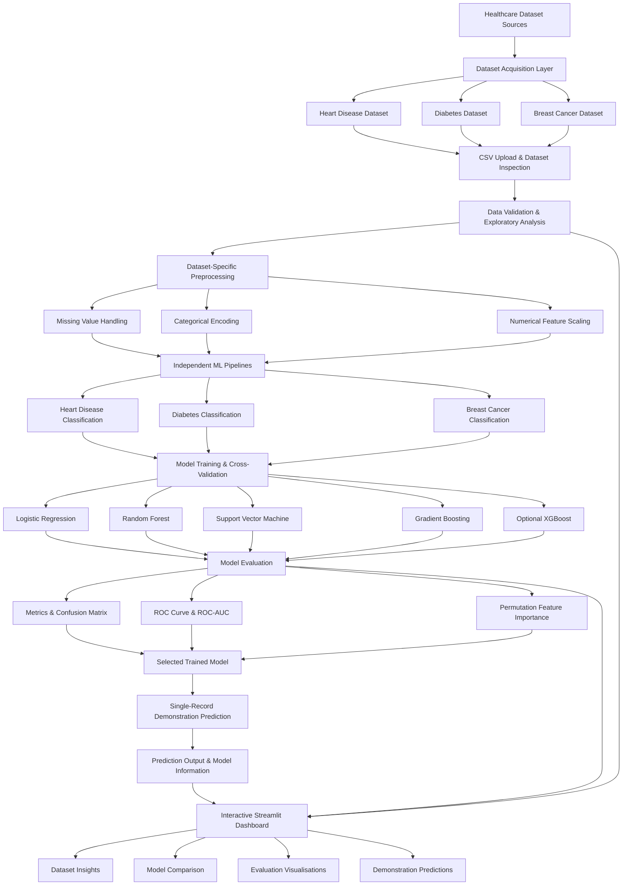
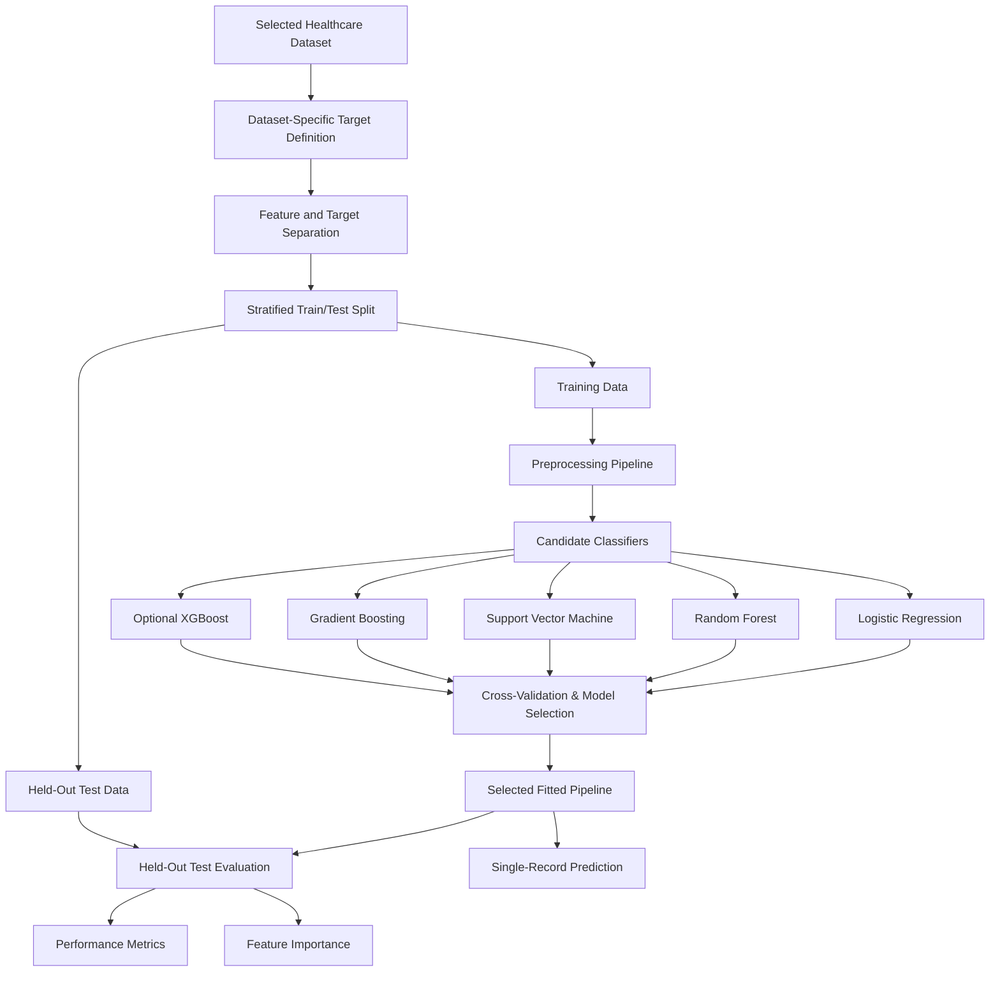

# Intelligent Predictive Healthcare Analytics Platform

## AI-Powered Healthcare Intelligence and Disease Prediction

An end-to-end **AI-powered Healthcare Analytics Platform** that integrates data preprocessing, exploratory analysis, machine learning, model evaluation, feature importance, and patient-level prediction across multiple healthcare datasets. The platform demonstrates independent predictive modelling workflows for heart disease, diabetes, and breast cancer classification. It combines Logistic Regression, Random Forest, Support Vector Machine, Gradient Boosting, and optional XGBoost models with an interactive Streamlit dashboard for exploring analytical results and demonstration predictions.

> **Important Medical Disclaimer:** This project is an educational and research-oriented analytics prototype. It is not a medical device, diagnostic service, or clinically validated decision-support system. Predictions must not be used for diagnosis, treatment, screening, or other clinical decisions. All model outputs require independent clinical and external validation before any consideration of real-world use.

---

## Project Objectives

- Develop an integrated analytics platform for multiple disease-prediction tasks.
- Process and analyse structured healthcare datasets.
- Implement reusable preprocessing and machine-learning pipelines.
- Train independent classification models for different disease datasets.
- Compare predictive performance using appropriate evaluation metrics.
- Identify influential input features using permutation importance.
- Support demonstration predictions for individual records.
- Visualise model results through an interactive Streamlit dashboard.
- Demonstrate responsible and reproducible machine-learning practices in healthcare analytics.

## Supported Prediction Tasks

The platform supports three independent classification workflows.

<badge color="info">3 independent prediction tasks</badge>

<box gap={3}>
  <row align=start gap={3}>
    <AsyncImage query="medical heart anatomy illustration human heart red anatomical educational" aspectRatio="1:1" maxWidth="104px"/>
    <box flex="1" gap={1}>
      **1. Heart Disease Prediction**

      Dataset: UCI Heart Disease

      Classification objective: Identify the dataset-defined heart disease outcome using structured patient features.

      Target: Common Cleveland processed dataset uses `num`, with values greater than zero treated as positive.
    </box>
  </row>
  <divider color="subtle"/>
  <row align=start gap={3}>
    <AsyncImage query="medical diabetes glucose blood sugar illustration educational" aspectRatio="1:1" maxWidth="104px"/>
    <box flex="1" gap={1}>
      **2. Diabetes Prediction**

      Dataset: Pima Indians Diabetes

      Classification objective: Predict the dataset-defined diabetes outcome from available health-related features.

      Target: `Outcome`.
    </box>
  </row>
  <divider color="subtle"/>
  <row align=start gap={3}>
    <AsyncImage query="medical breast cancer cell pathology illustration pink educational" aspectRatio="1:1" maxWidth="104px"/>
    <box flex="1" gap={1}>
      **3. Breast Cancer Classification**

      Dataset: Wisconsin Diagnostic Breast Cancer

      Classification objective: Classify the dataset-defined diagnostic label.

      Target: `diagnosis` (M/B) or an appropriately encoded numeric target.
    </box>
  </row>
</box>

Each prediction task is trained independently because the datasets have different feature sets, measurement definitions, populations, and target labels. A single shared model is not used across all three datasets.

## Key Features

- **Multi-Dataset Support:** Independent heart disease, diabetes, and breast cancer classification workflows.
- **CSV Data Upload:** Upload custom datasets and inspect their structure.
- **Exploratory Data Analysis:** Examine feature distributions, missing values, class balance, and dataset characteristics.
- **Data Preprocessing:** Handle missing values, encode categorical variables, and scale numerical features.
- **Multiple ML Algorithms:** Compare Logistic Regression, Random Forest, SVM, Gradient Boosting, and optional XGBoost.
- **Stratified Model Evaluation:** Support stratified train/test splitting and cross-validation where appropriate.
- **Performance Metrics:** Calculate accuracy, precision, recall, F1-score, ROC-AUC, and confusion matrices.
- **ROC Analysis:** Visualise classifier discrimination through ROC curves when applicable.
- **Feature Importance:** Use permutation importance to examine model-dependent feature contributions.
- **Patient-Level Demonstration Predictions:** Submit a single record for a model prediction using the selected trained pipeline.
- **Interactive Dashboard:** Explore datasets, train models, compare results, and view predictions.
- **Automated Testing:** Verify core preprocessing and evaluation functionality using unit tests.
- **Reproducibility:** Support documented dataset versions, target definitions, random seeds, and evaluation settings.

---

## System Architecture

The platform follows a modular, dataset-specific architecture that transforms uploaded healthcare datasets into evaluated machine-learning models and demonstration predictions.

The architecture is organised into seven major layers:

1. Data Acquisition and Dataset Management
2. Data Inspection and Exploratory Analysis
3. Data Preprocessing and Feature Engineering
4. Independent Disease Prediction Pipelines
5. Model Evaluation and Explainability
6. Patient-Level Demonstration Prediction
7. Interactive Dashboard and Reporting

### 1. Overall System Architecture



### 2. Architecture Components

| Layer | Component | Responsibility |
|---|---|---|
| Data Acquisition | UCI, Pima, Wisconsin datasets | Supplies the three dataset-specific classification tasks. |
| Data Upload | CSV uploader | Accepts supported datasets and custom CSV files. |
| Data Inspection | Schema and target inspection | Examines columns, data types, missing values, and target distribution. |
| Exploratory Analysis | Statistical summaries and charts | Explores distributions and class imbalance. |
| Preprocessing | Imputation, encoding, scaling | Prepares input features for model training. |
| Disease Pipelines | Three independent workflows | Maintains separate feature sets and target definitions. |
| Model Training | Five candidate algorithms | Trains and compares classification models. |
| Model Evaluation | Classification metrics | Measures predictive performance on held-out data. |
| Explainability | Permutation importance | Estimates how shuffling individual features affects a selected evaluation metric. |
| Prediction Engine | Selected fitted pipeline | Generates a demonstration prediction for a single input record. |
| Presentation | Streamlit dashboard | Presents model comparisons, analytical insights, and prediction results. |

### 3. Detailed Data Processing Architecture

**Stage 1 — Dataset Acquisition**

The platform supports three structured healthcare datasets:

- UCI Heart Disease dataset.
- Pima Indians Diabetes dataset.
- Wisconsin Diagnostic Breast Cancer dataset.

Datasets are obtained from their respective sources and supplied as CSV files where required.

Each dataset maintains its own schema and target definition.

**Stage 2 — CSV Upload and Data Inspection**

Uploaded datasets are examined before model training.

The inspection process includes:

- Dataset dimensions.
- Column names and data types.
- Missing-value counts.
- Duplicate record checks.
- Numerical and categorical feature identification.
- Target-variable selection.
- Target-class distribution.

This stage helps identify structural problems before preprocessing.

**Stage 3 — Exploratory Data Analysis**

Exploratory analysis examines the characteristics of the selected dataset.

Potential visualisations include:

- Target-class distribution.
- Feature histograms.
- Box plots.
- Correlation heatmaps.
- Numerical feature summaries.
- Class imbalance visualisations.

The purpose is to understand the dataset and identify potential data-quality concerns.

**Stage 4 — Data Preprocessing**

The preprocessing pipeline prepares data for classification.

| Operation | Purpose |
|---|---|
| Missing-Value Handling | Imputes or handles incomplete observations using configured strategies. |
| Categorical Encoding | Converts categorical variables into numerical representations. |
| Feature Scaling | Standardises numerical variables for scale-sensitive algorithms. |
| Target Encoding | Converts target labels into the required classification representation. |
| Train/Test Splitting | Separates training and held-out evaluation observations. |

Preprocessing transformations must be fitted using training data only. A scikit-learn Pipeline or ColumnTransformer helps prevent data leakage by applying fitted transformations consistently to test and prediction records.

**Stage 5 — Independent Disease Prediction Pipelines**

Each disease task receives its own preprocessing and modelling workflow.



**Stage 6 — Model Training**

The system supports the following algorithms:

| Algorithm | Description |
|---|---|
| Logistic Regression | Linear classification baseline. |
| Random Forest | Ensemble of decision trees. |
| Support Vector Machine | Margin-based classification algorithm. |
| Gradient Boosting | Sequential ensemble learning method. |
| XGBoost | Optional gradient-boosted tree implementation. |

Model selection should be performed using training data and cross-validation where applicable. The held-out test set should remain separate for final evaluation.

**Stage 7 — Model Evaluation**

The trained classifiers are evaluated using appropriate classification metrics.

- Accuracy
- Precision
- Recall
- F1-score
- ROC-AUC
- Confusion matrix
- ROC curve

For imbalanced datasets, accuracy alone can be misleading. Precision, recall, F1-score, and class-specific confusion matrix results should be considered together.

**Stage 8 — Feature Importance and Explainability**

The platform uses permutation feature importance to estimate the effect of individual features on model performance.

The method:

1. Evaluates the fitted model on a selected dataset.
2. Measures the baseline evaluation score.
3. Randomly shuffles one feature at a time.
4. Measures the resulting performance change.
5. Repeats the procedure.
6. Ranks features by their average impact.

Permutation importance is model-agnostic, but it is not a causal explanation. Correlated features can distribute or obscure importance, and the results depend on the evaluation dataset and scoring metric.

**Stage 9 — Patient-Level Demonstration Prediction**

A selected fitted pipeline accepts a single record containing the required model input features.

The prediction workflow includes:

- Collecting the required feature values.
- Validating the input schema.
- Applying the fitted preprocessing transformations.
- Generating a model prediction.
- Returning the predicted dataset class.
- Displaying model and dataset context.

If supported by the fitted classifier, the dashboard may also display class probabilities.

A predicted class or probability is a model output, not a diagnosis or an individual's clinically established disease risk.

**Stage 10 — Dashboard and Reporting**

The Streamlit dashboard brings together dataset exploration, model training, evaluation, and demonstration predictions.

Potential dashboard sections include:

- Healthcare analytics overview.
- Dataset upload and inspection.
- Exploratory data analysis.
- Disease-specific model training.
- Model comparison.
- Confusion matrix and ROC visualisation.
- Permutation feature importance.
- Single-record demonstration prediction.
- Evaluation summaries.

---

## Dataset Setup and Sources

Download the datasets from their original sources and place the prepared CSV files inside `data/raw/`.

| Prediction Task | Dataset | Original Source |
|---|---|---|
| Heart Disease | UCI Heart Disease | [UCI Repository](https://archive.ics.uci.edu/dataset/45/heart+disease) |
| Diabetes | Pima Indians Diabetes | [UCI Repository](https://archive.ics.uci.edu/dataset/34/diabetes) |
| Breast Cancer | Wisconsin Diagnostic Breast Cancer | [Scikit-learn Documentation](https://scikit-learn.org/stable/modules/generated/sklearn.datasets.load_breast_cancer.html) |

### Expected Dataset Files

```text
data/
└── raw/
    ├── heart_disease.csv
    ├── diabetes.csv
    └── breast_cancer.csv
```

These filenames are suggested conventions. Use the actual filenames configured in the application.

### Target Variable Definitions

| Dataset | Common Target Column | Positive Class |
|---|---|---|
| Heart Disease | `num` | Values greater than 0 |
| Diabetes | `Outcome` | 1 |
| Breast Cancer | `diagnosis` | M = malignant, B = benign |

**Dataset preparation considerations:**

- The common processed Cleveland heart disease file uses `num`. Values greater than zero are commonly grouped as positive, but document this binary conversion.
- The Pima dataset commonly uses `Outcome` as its binary target.
- The Wisconsin Diagnostic Breast Cancer dataset commonly uses `diagnosis`, with `M` and `B` labels.
- If using the Scikit-learn breast cancer loader, verify the positive-class convention because its target encoding and class ordering may differ from the CSV representation.
- Ensure the target is excluded from input features.
- Check for duplicate observations and inconsistent feature definitions.
- Document dataset versions, sources, and preprocessing decisions.

Check the dataset licenses and usage terms before redistribution. Do not commit patient-identifiable or sensitive data.

---

## Technology Stack

| Category | Technologies |
|---|---|
| Programming Language | Python |
| Data Processing | Pandas, NumPy |
| Machine Learning | Scikit-learn |
| Classification Models | Logistic Regression, Random Forest, SVM, Gradient Boosting |
| Optional Boosting | XGBoost |
| Data Visualisation | Matplotlib, Seaborn |
| Dashboard | Streamlit |
| Model Evaluation | Scikit-learn Metrics |
| Feature Importance | Permutation Importance |
| Testing | Pytest |
| Dataset Format | CSV |
| Development Environment | Jupyter Notebook, VS Code |
| Version Control | Git, GitHub |

---

## Repository Structure

```text
Intelligent-Predictive-Healthcare-Analytics/
│
├── dashboard/
│   └── app.py
│
├── data/
│   └── raw/
│       └── README.md
│
├── docs/
│   ├── architecture.md
│   ├── methodology.md
│   └── limitations.md
│
├── notebooks/
│   └── README.md
│
├── reports/
│   └── figures/
│
├── src/
│   ├── data_loader.py
│   ├── preprocessing.py
│   ├── feature_engineering.py
│   ├── modeling.py
│   ├── evaluation.py
│   └── prediction.py
│
├── models/
│   └── README.md
│
├── tests/
│   ├── test_preprocessing.py
│   └── test_evaluation.py
│
├── requirements.txt
├── config.py
├── README.md
└── .gitignore
```

*This is a suggested organisation based on the described architecture. Keep the structure aligned with the actual files in the repository.*

---

## Installation and Setup

### Prerequisites

- Python 3.10–3.12
- pip package manager
- Git (optional)

### 1. Clone the Repository

```bash
git clone <repository-url>
cd Intelligent-Predictive-Healthcare-Analytics
```

### 2. Create a Virtual Environment

```bash
python -m venv venv
```

**Windows:**

```bash
venv\Scripts\activate
```

**macOS / Linux:**

```bash
source venv/bin/activate
```

### 3. Install Dependencies

```bash
pip install -r requirements.txt
```

### 4. Prepare the Datasets

Download the selected datasets from their original sources and place the prepared CSV files in `data/raw/`.

Verify the feature columns and target-variable definitions before loading them into the application.

### 5. Launch the Streamlit Dashboard

```bash
streamlit run dashboard/app.py
```

Open the local URL displayed in the terminal to access the healthcare analytics platform.

### 6. Train and Evaluate Models

1. Select the required disease-prediction task.
2. Upload or select the relevant dataset.
3. Inspect the dataset and select the target column.
4. Configure the positive class where required.
5. Choose the candidate machine-learning algorithms.
6. Train the models using the training data.
7. Compare evaluation metrics and visualisations.
8. Inspect permutation feature importance.
9. Explore a single-record demonstration prediction.

---

## Model Training and Testing

### Model Training

The project supports model training through its configured application workflow and reusable Python modules.

The general training process is:

1. Load the selected dataset.
2. Define the target column and positive class.
3. Separate features and target.
4. Perform a stratified train/test split where appropriate.
5. Fit preprocessing transformations on training data.
6. Train candidate classifiers.
7. Perform cross-validation for model selection.
8. Evaluate the selected model on held-out test data.
9. Save model artifacts where configured.

### Model Saving

Trained model artifacts may be saved in the `models/` directory.

Persist the complete fitted preprocessing-and-model pipeline rather than only the classifier, so that new prediction records receive the same transformations.

Only load trusted model artifacts. Python pickle-based formats can execute code when loaded from untrusted sources.

### Automated Testing

Run the unit tests using:

```bash
pytest -q
```

The tests should cover:

- Missing-value handling.
- Categorical encoding.
- Feature and target separation.
- Input schema validation.
- Preprocessing consistency.
- Evaluation metric calculations.
- Prediction pipeline functionality.

---

## Model Evaluation

The platform uses standard classification metrics to compare the candidate models.

| Metric | Description |
|---|---|
| Accuracy | Overall proportion of correctly classified observations. |
| Precision | Proportion of predicted positive observations that are correct. |
| Recall | Proportion of actual positive observations correctly identified. |
| F1-Score | Harmonic mean of precision and recall. |
| ROC-AUC | Measures discrimination across classification thresholds. |
| Confusion Matrix | Summarises true positives, true negatives, false positives, and false negatives. |

### Evaluation Considerations

- Use stratified splitting when appropriate to preserve class proportions.
- Perform preprocessing inside the training pipeline to avoid leakage.
- Use cross-validation only within the training data for model selection.
- Keep the held-out test set separate from model tuning.
- Consider class imbalance and class-specific error rates.
- Record the random seed and dataset version.
- Evaluate calibration separately if predicted probabilities are presented.
- Use external validation to assess generalisation beyond the original dataset.

### Results Reporting

Do not publish invented or illustrative performance scores as experimental results.

After executing the pipeline, document:

| Information | What to Record |
|---|---|
| Dataset | Name and version |
| Target Definition | Target column and positive class |
| Sample Size | Number of observations |
| Features | Number and names of input variables |
| Split Strategy | Training and testing proportions |
| Random Seed | Reproducibility setting |
| Model | Algorithm and hyperparameters |
| Metrics | Accuracy, precision, recall, F1, ROC-AUC |
| Validation | Cross-validation or external validation details |

---

## Suggested Dashboard Screenshots

For a professional GitHub presentation, include genuine screenshots of:

1. **Dashboard Overview** – platform interface and key analytics sections.
2. **Dataset Inspection** – uploaded dataset preview, missing values, and target distribution.
3. **Model Comparison** – comparison of trained classification algorithms.
4. **Confusion Matrix** – actual versus predicted class distribution.
5. **ROC Curve** – model discrimination visualisation.
6. **Feature Importance** – permutation importance rankings.
7. **Demonstration Prediction** – single-record model output, clearly labelled as an educational demonstration.

Store screenshots in `reports/figures/` or a dedicated `screenshots/` directory and reference the actual image paths in the README.

---

## Limitations

- The platform uses publicly available benchmark datasets and does not establish clinical validity.
- Dataset labels may be noisy, outdated, incomplete, or unrepresentative of current patient populations.
- The three classification tasks use different features and target definitions and cannot be interpreted as one unified clinical model.
- Held-out test performance does not establish real-world clinical effectiveness.
- Feature importance does not establish causality or clinical relevance.
- Predicted probabilities are not necessarily calibrated estimates of individual disease risk.
- Dataset-specific performance may not generalise across hospitals, devices, populations, or clinical settings.
- Missing values, class imbalance, feature correlation, and data leakage can affect model evaluation.
- No diagnosis, treatment recommendation, or clinical decision-making functionality is established by this educational prototype.

## Responsible Use and Healthcare Data Privacy

This platform is intended exclusively for educational, research, and portfolio demonstration purposes.

- Do not use model predictions to diagnose diseases.
- Do not use predictions to recommend treatment or medication.
- Do not make patient-care decisions based solely on model outputs.
- Do not upload identifiable patient information into this demonstration application.
- Use appropriately licensed and authorised datasets.
- Apply secure storage and access controls to sensitive information.
- Evaluate fairness and subgroup performance across relevant populations.
- Validate calibration, clinical relevance, and external generalisation.
- Require independent clinical, ethical, and regulatory review before any real-world clinical research or deployment.
- Maintain qualified healthcare professional oversight in any future clinical evaluation.

---

## Future Enhancements

- Integration with authorised electronic health record datasets.
- External validation using independently collected datasets.
- Model calibration and probability reliability analysis.
- Fairness and subgroup performance evaluation.
- Explainable AI using SHAP.
- Advanced feature selection and hyperparameter optimisation.
- Ensemble learning and model stacking.
- Improved data-quality monitoring.
- Model versioning and experiment tracking.
- Secure role-based dashboard access.
- Privacy-preserving healthcare analytics.
- Deployment monitoring and model drift detection.
- Clinical expert review workflows, subject to appropriate validation and governance.

## Conclusion

The Intelligent Predictive Healthcare Analytics Platform demonstrates how structured healthcare datasets, data preprocessing, machine learning, model evaluation, and interactive visualisation can be integrated into a unified analytical environment.

By implementing independent classification workflows for heart disease, diabetes, and breast cancer, the project explores how different machine-learning algorithms can be trained and compared across multiple healthcare prediction tasks.

The platform provides a foundation for learning healthcare data analytics and responsible predictive modelling while emphasising the importance of dataset quality, reproducibility, privacy, fairness, external validation, and clinical oversight.

---

## Author

**Mohamed Riyaz S.**  
Integrated M.Tech – Computer Science and Engineering (Business Analytics)  
Vellore Institute of Technology (VIT), Chennai
